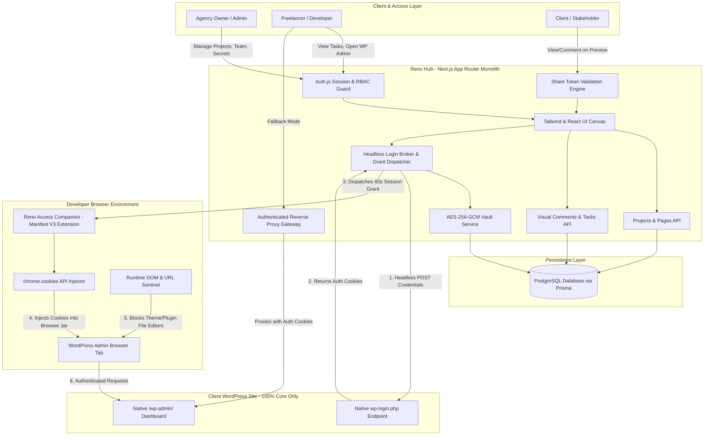
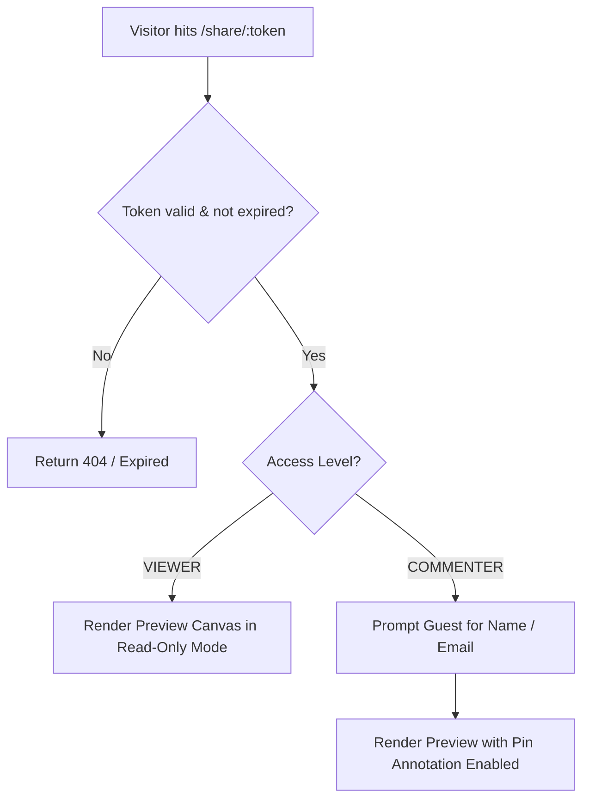
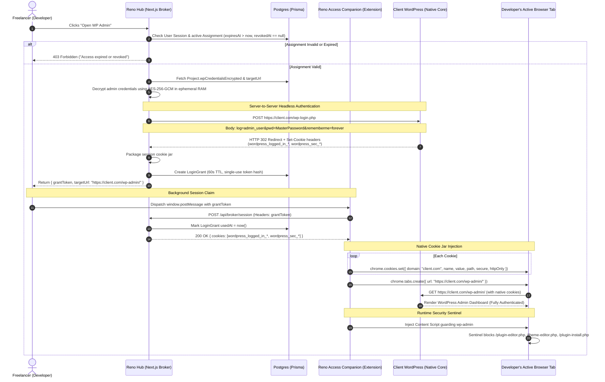
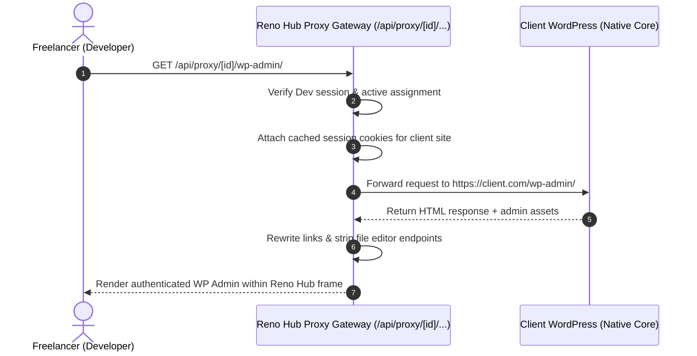

# SYSTEM ARCHITECTURE: RENO HUB

## 1. High-Level System Architecture (Zero-Plugin Hybrid)



---

## 2. Visual Preview & Annotation Subsystem

### 2.1 Canvas Math & Coordinate Normalization
In visual web annotators, fixed pixel coordinates fail when switching between viewports or scaling zoom. 
Reno Hub uses **normalized percentage coordinates** combined with target viewport metadata:

```typescript
// Coordinate calculation when a pin is placed on the canvas
interface RawClickEvent {
  clientX: number;
  clientY: number;
  canvasRect: DOMRect;
  scrollOffset: number;
  activeViewportWidth: number;
  activeViewportHeight: number;
}

export function calculateNormalizedPosition(e: RawClickEvent) {
  const relativeX = e.clientX - e.canvasRect.left;
  const relativeY = (e.clientY - e.canvasRect.top) + e.scrollOffset;

  return {
    // Stored as percentage of current viewport (0.00% to 100.00%)
    posX: Number(((relativeX / e.activeViewportWidth) * 100).toFixed(2)),
    posY: Number(((relativeY / e.activeViewportHeight) * 100).toFixed(2)),
    viewportWidth: e.activeViewportWidth,
    viewportHeight: e.activeViewportHeight,
    scrollY: Math.round(e.scrollOffset),
  };
}
```

### 2.2 Rendering Pins on Canvas
When rendering an `AnnotationMarker` over the preview iframe:
- `left = ${pin.posX}%`
- `top = ${pin.posY * (activeViewportHeight / 100)}px`
- CSS `transform: translate(-50%, -100%)` anchors the needle of the pin exactly to the target element.

---

## 3. Client Share Link Security & Permission Scoping

### 3.1 Token Generation & Cryptography
Share links use a CSPRNG token generated via Node's `crypto.randomBytes(32).toString('base64url')` (256 bits of entropy).
Tokens are indexed in the `ShareLink` table:
- Lookups take `O(1)` time.
- Route: `/share/[token]`.

### 3.2 Role Matrix for Share Links

- **Isolated Surface**: The `/share/[token]` layout does **not** import any project manager navigation, developer assignment drawers, or WordPress broker buttons.

---

## 4. Zero-Plugin Hybrid WordPress Access Broker (Option 2 + Option 4)

### 4.1 Primary Handshake Sequence Diagram (Extension Mode)



### 4.2 Fallback Handshake Sequence Diagram (Proxy Gateway Mode)

For environments where installing the extension is restricted, Reno Hub operates as an **authenticated reverse proxy gateway**:


### 4.3 Runtime Security Sentinel (Extension Guardrails)
Since no `mu-plugin` exists on the WordPress site, security restrictions are enforced on the client side by the Reno Access Companion extension:
1. **URL Interception**: Background script hooks `chrome.webNavigation.onBeforeNavigate`:
   - If URL matches `*/wp-admin/plugin-editor.php*`, `*/wp-admin/theme-editor.php*`, or `*/wp-admin/plugin-install.php*`:
     - Aborts navigation and displays a sleek Reno Hub security modal: `"Restricted Area: File editing and plugin installations are locked by your agency owner."`
2. **DOM Sentinel**: Injected content script removes dangerous navigation elements:
   - Removes `#menu-plugins ul li:has(a[href="plugin-install.php"])`
   - Removes `#menu-plugins ul li:has(a[href="plugin-editor.php"])`
   - Removes `#menu-appearance ul li:has(a[href="theme-editor.php"])`
   - Disables creating new users with the `administrator` role.
3. **Instant Cookie Clearing**:
   - When assignment expires or Admin clicks "Revoke", Reno Hub notifies the extension, which immediately calls `chrome.cookies.remove()` for all `client.com` cookies, terminating the developer's session immediately.

---

## 5. Database Schema (Prisma)

```prisma
datasource db {
  provider = "postgresql"
  url      = env("DATABASE_URL")
}

generator client {
  provider = "prisma-client-js"
}

enum Role {
  ADMIN
  DEVELOPER
}

enum ProjectStatus {
  ACTIVE
  ARCHIVED
}

enum CommentStatus {
  PENDING
  IN_PROGRESS
  RESOLVED
}

enum ShareAccessLevel {
  VIEWER
  COMMENTER
}

enum WpRoleTemplate {
  EDITOR
  SHOP_MANAGER
  RESTRICTED_ADMIN
}

model User {
  id               String       @id @default(uuid())
  email            String       @unique
  name             String
  passwordHash     String
  role             Role         @default(DEVELOPER)
  avatarUrl        String?
  assignments      Assignment[]
  commentsAuthored Comment[]    @relation("CommentAuthor")
  commentsResolved Comment[]    @relation("CommentResolver")
  repliesAuthored  CommentReply[]
  auditLogs        AuditLog[]
  createdAt        DateTime     @default(now())
  updatedAt        DateTime     @updatedAt
}

model Project {
  id                      String        @id @default(uuid())
  name                    String
  clientName              String
  targetUrl               String
  wpAdminUsernameEncrypted String
  wpAdminUsernameIv       String
  wpAdminUsernameAuthTag  String
  wpAdminPasswordEncrypted String
  wpAdminPasswordIv       String
  wpAdminPasswordAuthTag  String
  status                  ProjectStatus @default(ACTIVE)
  pages                   ProjectPage[]
  assignments             Assignment[]
  comments                Comment[]
  shareLinks              ShareLink[]
  auditLogs               AuditLog[]
  createdAt               DateTime      @default(now())
  updatedAt               DateTime      @updatedAt
}

model ProjectPage {
  id           String    @id @default(uuid())
  projectId    String
  project      Project   @relation(fields: [projectId], references: [id], onDelete: Cascade)
  path         String
  fullUrl      String
  title        String
  isDefault    Boolean   @default(false)
  isHidden     Boolean   @default(false)
  displayOrder Int       @default(0)
  comments     Comment[]
  createdAt    DateTime  @default(now())

  @@unique([projectId, path])
}

model Assignment {
  id             String         @id @default(uuid())
  projectId      String
  project        Project        @relation(fields: [projectId], references: [id], onDelete: Cascade)
  userId         String
  user           User           @relation(fields: [userId], references: [id], onDelete: Cascade)
  wpRoleTemplate WpRoleTemplate @default(RESTRICTED_ADMIN)
  expiresAt      DateTime
  revokedAt      DateTime?
  loginGrants    LoginGrant[]
  createdAt      DateTime       @default(now())
  updatedAt      DateTime       @updatedAt

  @@unique([projectId, userId])
}

model Comment {
  id                 String        @id @default(uuid())
  projectId          String
  project            Project       @relation(fields: [projectId], references: [id], onDelete: Cascade)
  pageId             String
  page               ProjectPage   @relation(fields: [pageId], references: [id], onDelete: Cascade)
  authorUserId       String?
  authorUser         User?         @relation("CommentAuthor", fields: [authorUserId], references: [id], onDelete: SetNull)
  guestAuthorName    String?
  guestAuthorEmail   String?
  content            String        @db.Text
  posX               Float
  posY               Float
  viewportWidth      Int
  viewportHeight     Int
  scrollY            Int           @default(0)
  status             CommentStatus @default(PENDING)
  resolvedAt         DateTime?
  resolvedByUserId   String?
  resolvedByUser     User?         @relation("CommentResolver", fields: [resolvedByUserId], references: [id], onDelete: SetNull)
  replies            CommentReply[]
  createdAt          DateTime      @default(now())
  updatedAt          DateTime      @updatedAt
}

model CommentReply {
  id               String   @id @default(uuid())
  commentId        String
  comment          Comment  @relation(fields: [commentId], references: [id], onDelete: Cascade)
  authorUserId     String?
  authorUser       User?    @relation(fields: [authorUserId], references: [id], onDelete: SetNull)
  guestAuthorName  String?
  content          String   @db.Text
  createdAt        DateTime @default(now())
}

model ShareLink {
  id          String           @id @default(uuid())
  projectId   String
  project     Project          @relation(fields: [projectId], references: [id], onDelete: Cascade)
  token       String           @unique
  accessLevel ShareAccessLevel @default(VIEWER)
  expiresAt   DateTime?
  isRevoked   Boolean          @default(false)
  createdAt   DateTime         @default(now())
}

model LoginGrant {
  id           String     @id @default(uuid())
  tokenHash    String
  assignmentId String
  assignment   Assignment @relation(fields: [assignmentId], references: [id], onDelete: Cascade)
  sessionDataEncrypted String @db.Text
  sessionDataIv        String
  sessionDataAuthTag   String
  expiresAt    DateTime   // 60-second TTL
  usedAt       DateTime?
  createdAt    DateTime   @default(now())
}

model AuditLog {
  id        String   @id @default(uuid())
  userId    String?
  user      User?    @relation(fields: [userId], references: [id], onDelete: SetNull)
  projectId String?
  project   Project? @relation(fields: [projectId], references: [id], onDelete: SetNull)
  action    String
  ipAddress String
  userAgent String
  metadata  Json?
  timestamp DateTime @default(now())
}
```
